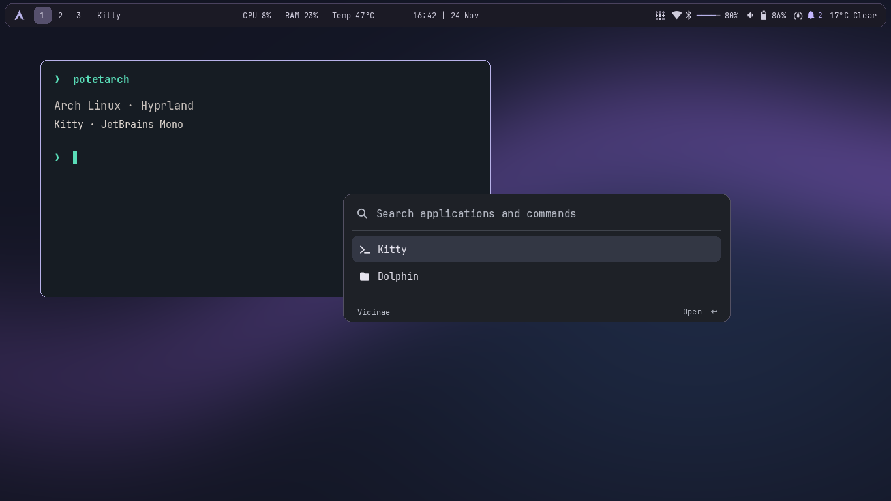
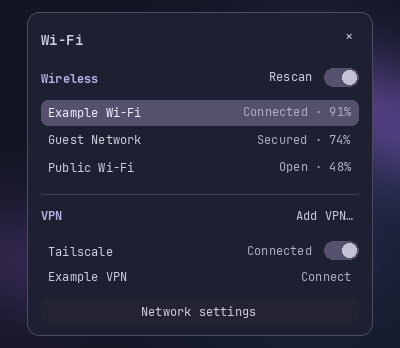
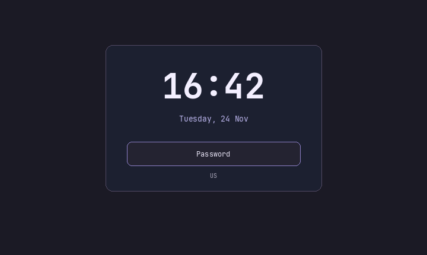

# potetarch dotfile

My Arch Linux and Hyprland desktop with a floating lavender Waybar, custom
GTK menus for Wi-Fi, VPNs, and sound, and a matching notification center
and lock screen.



*The images on this page are illustrations rendered from the configuration
with sample data. The desktop preview uses an illustrative background.*

## Install

On Arch Linux, from your regular user account:

```sh
git clone https://github.com/wasiulhaque/potetarch-dotfile.git
cd potetarch-dotfile
./install.sh
```

The installer upgrades Arch and installs the desktop packages through Pacman.
It uses `yay` for Vicinae and Waypaper if either is missing. Install those
AUR packages yourself or have `yay` available. If you already have the
dependencies, run `./install.sh --config-only` with Python 3 installed.

The script copies the files to `${XDG_CONFIG_HOME:-~/.config}` and backs up
files it replaces under `${XDG_STATE_HOME:-~/.local/state}/potetarch/`. It
prints the backup path. To restore, copy the backed-up files to your config
directory and remove any newly installed files you no longer want. Log out
and back into Hyprland to load the full setup.

The source desktop runs Hyprland 0.57.2 and Waybar 0.16.0. If you are switching
from a legacy `hyprland.conf`, make sure the session loads `hyprland.lua`.

## Hyprland

The [Lua config](config/hypr/hyprland.lua) puts the main application commands,
display scaling, gaps, borders, and media key increments at the top. Displays
use their preferred mode, automatic positioning, and 1× scaling. The desktop
uses Dwindle tiling, 2 px inner gaps, 5 px outer gaps, lavender active borders,
10 px window rounding, shadows, and background blur.

Window entry uses a spring with a pop-in transition. Workspaces slide
horizontally. The US keyboard layout and natural touchpad scrolling are enabled,
and a three-finger horizontal swipe changes workspaces. The config includes
rules for the Vicinae layer, maximize requests, XWayland drag windows, and the
Hyprland run dialog. The [HyprMod settings file](config/hypr/hyprland-gui.lua)
hides the default logo and splash.

Startup launches Waybar, Vicinae, Hypridle, and awww, then restores the wallpaper
through Waypaper. Hyprland also starts SwayNC and the KDE PolicyKit agent as
systemd user services.

### General shortcuts

| Shortcut | Action |
| --- | --- |
| Super + Return / E | Open Kitty / Dolphin |
| Super + Space or R | Open Vicinae |
| Super + N / L | Open notifications / lock the screen |
| Super + Q / M | Close the focused window / log out |
| Super + Up / Down | Focus the window above / below |
| Super + V / P / J | Toggle floating / pseudotiling / the split direction |
| Super + left-drag / right-drag | Move / resize the focused window |
| Brightness, audio, and playback keys | Adjust brightness or volume in 5% steps, mute sound or mic, and control playback |

### Workspace shortcuts

These shortcuts make multiple workspaces easy to use on a single screen.
Use the arrow keys to move between tasks, jump straight to a numbered
workspace, or send a window to the next workspace and follow it. An empty
workspace is one shortcut away when you need a clean space.

| Shortcut | Action |
| --- | --- |
| Super + Left / Right | Switch to an adjacent workspace |
| Super + Shift + Left / Right | Move the focused window and follow it |
| Super + Shift + Down | Jump to the next empty workspace on this monitor |
| Super + 1–0 / Super + Shift + 1–0 | Switch to workspace 1–10 / move the focused window there |
| Super + S / Super + Shift + S | Toggle the scratchpad / send the focused window there |
| Super + scroll | Cycle through existing workspaces |
| Three-finger horizontal swipe | Switch workspaces on a touchpad |

## Waybar

The [bar layout](config/waybar/config.jsonc) uses one 36 px floating panel per
display. The [stylesheet](config/waybar/style.css) supplies the translucent
violet background, thin border, rounded corners, JetBrains Mono Nerd Font,
and matching active, hover, urgent, and tooltip colors.

- **Left** has an Arch icon that opens Vicinae, three persistent workspace
  indicators, the focused window title, and CPU, RAM, and temperature readings.
  Workspaces 1–3 are always shown. Higher-numbered workspaces appear when
  Hyprland creates them on that display and disappear when it removes them.
- **Center** has the clock and date, an alternate long date on click, and a
  calendar tooltip.
- **Right** has Tailscale status, network and sound controls, brightness,
  battery, power profile, tray, notifications, and current weather.

The [Tailscale module](config/waybar/tailscale-status.py) changes the dot icon’s
opacity with connection state and shows a status tooltip. [Weather](config/waybar/weather.py)
uses Open-Meteo and refreshes about every 15 minutes after a successful fetch.
To enable it, create `weather-location.json` next to the installed script with
your coordinates, for example `{"latitude": 51.51, "longitude": -0.13}`, and
restart Waybar. The coordinates are sent to Open-Meteo.

Brightness and battery depend on available hardware. The temperature module
uses the Intel `coretemp` sensor by default. Set the sensor in Waybar’s config
to match your hardware.

## Wi-Fi, VPN, and sound menus

The network and volume modules open [custom GTK 4 panels](config/waybar/controls.py).
They use Wayland layer shell and position themselves below the bar on the
selected display. Both panels use the same violet cards, lavender selection
colors, and compact settings buttons.

| Wi-Fi and VPN | Sound |
| --- | --- |
|  |  |

- **Wi-Fi** shows nearby networks with signal strength and security status,
  highlights the connected network, and exposes a radio switch and rescan
  button. Saved networks can reconnect directly. Supported secured networks
  can be joined with an inline password prompt. **Network settings** opens
  NetworkManager’s connection editor.
- **VPN** lists saved NetworkManager VPN and WireGuard profiles and lets you
  connect or disconnect them. **Add VPN…** opens the connection editor.
  Tailscale gets its own status and switch when available. Changes use the
  configured Tailscale operator or the desktop PolicyKit prompt.
- **Sound** lists output and input devices, lets you change the default
  device, and gives the selected output and input their own volume sliders.
  The sliders preserve channel balance. **Audio settings** opens Pavucontrol.
  In Waybar, scroll adjusts volume and right-click toggles output mute.

The Wi-Fi menu uses NetworkManager. The sound menu uses PipeWire’s PulseAudio
compatibility layer. Tailscale is optional and uses your existing daemon and
sign-in.

## SwayNC notifications

The [notification center](config/swaync/config.json) opens below Waybar at the
top right. It contains Do Not Disturb, media controls that hide when idle, and
notification history. The [CSS](config/swaync/style.css) applies the same font
and violet palette to the center, notification cards, and media controls.
Left-click the Waybar bell or press **Super + N** to open it. Right-click the
bell to toggle Do Not Disturb.


## Hyprlock and Hypridle



[Hyprlock](config/hypr/hyprlock.conf) uses a solid dark background with a
rounded, lavender-bordered card. The time, date, password field, and keyboard
layout share the Waybar palette. The password field has separate checking and
failure states. Click the keyboard layout indicator to cycle layouts.

Press **Super + L** to lock. [Hypridle](config/hypr/hypridle.conf) handles
session lock requests and waits for the lock screen to activate before sleep.

## Vicinae, Kitty, and wallpaper

- [**Vicinae**](config/vicinae/settings.json) uses the One Dark theme, JetBrains
  Mono Nerd Font, a compact launcher, and a floating status bar at 90% window
  opacity. Hyprland blurs the launcher background and disables its layer
  animation. AI and Raycast compatibility providers are disabled.
- [**Kitty**](config/kitty/kitty.conf) uses Bogster (Dark), an 8 px inset on
  the top and left, and Zsh as its shell.
- [**Waypaper**](config/waypaper/config.ini) uses awww and fill scaling with
  animated transitions. Pick an image in Waypaper or run
  `./install.sh --config-only --wallpaper /path/to/image.png`. Keep the image
  available at the selected path. The local Peanuts wallpaper is excluded
  because its redistribution source is unverified.

## Screenshot shortcuts

| Shortcut | Capture |
| --- | --- |
| Print | Select a region |
| Shift + Print | Select an output |
| Ctrl + Print | Select a window |

Hyprshot saves a PNG and copies it to the clipboard. Set `HYPRSHOT_DIR` in
your session environment to choose the save folder.

## To-do

- [ ] Add a hotkey to open a monitor layout picker.
- [ ] Add profiles for mirroring, extending the desktop, using only the
  built-in display, and using only the external display.
- [ ] Handle monitor disconnects and restore a usable layout automatically.

## Credits

- The original desktop and visual inspiration came from
  [retrilzzy/dotfiles](https://github.com/retrilzzy/dotfiles).
- The local `hyprland-waybar-arch-starter.zip` supplied the initial Waybar and
  SwayNC layouts and integration snippets used for this version.
- The compositor config also builds on [Hyprland’s default config and Lua API](https://wiki.hypr.land/).
- Kitty uses the Bogster (Dark) port by lhs, based on [Bogster by vv9k](https://github.com/vv9k/bogster).
- The Waybar status icon adapts the dot geometry from the [Tailscale favicon](https://tailscale.com/favicon.svg).
- OpenAI Codex helped package the dotfiles, write the installer and README,
  and create the configuration-based preview illustrations.

## License

Original work in this repository is licensed under the GNU General Public
License, version 3 only ([GPL-3.0-only](LICENSE)). Third-party components
retain their upstream licensing terms.
